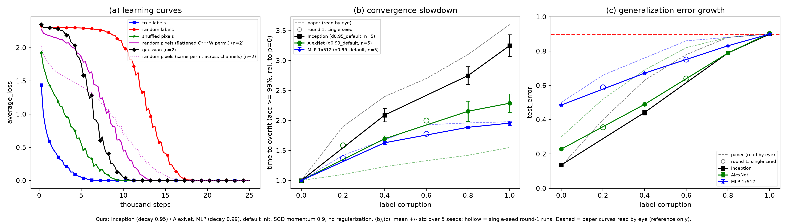

# Reproducing Figure 1 of "Understanding Deep Learning Requires Rethinking Generalization" (Zhang et al., ICLR 2017)

CS 6362 Assignment 2, Paper 1. Everything here was produced in PyTorch by iterating with an LLM through its chat interface.

- **LLM used:** Claude (Anthropic), claude.ai chat. Model/version: `<FILL IN, e.g. Claude Sonnet 5.5; confirm in the chat's model selector>`
- **Shared conversation link:** `<FILL IN>`
- **Existing implementations:** none were consulted or retrieved during Phases 1-3. Phase 4 notes are at the bottom.



*(a) Inception training loss on CIFAR10. (b) Time to overfit (first epoch with train accuracy >= 99%, relative to p=0). (c) Test error at the stop epoch.
(b),(c): mean +/- std over 5 seeds; hollow markers are single-seed round-1 runs. Dashed lines are the paper's curves read by eye (about +-0.02 in (c), +-0.1 in (b)); reference only.*

## Result in one table

| Panel | Ours | Paper (by eye) | Verdict |
|---|---|---|---|
| (a) ordering | true < shuffled < Gaussian < random pixels < random labels | same | matches; our curves are ~1.2x slower in steps |
| (b) Inception, p=1 | 3.25 +/- 0.18 | ~3.6 | close |
| (b) MLP 1x512, p=1 | 1.96 +/- 0.04 | ~2.0 | matches (needs LR decay >= 0.99) |
| (b) AlexNet, p=1 | 2.29 +/- 0.15 | ~1.55 | **mismatch**, ~5x the seed std |
| (c) endpoints | p=0 and p=1 agree for all three models | | matches |
| (c) shape, p=0.4 | Inception 0.442, AlexNet 0.490, MLP 0.672 | ~0.63, ~0.69, ~0.76 | **mismatch**: ours is ~linear, the paper's is concave |

Random pixels: the variant that permutes positions identically across channels leaks colour statistics (trained test error 0.63, chance is 0.9). Permuting the flattened C*H*W vector removes most of that (0.855). Gaussian is at chance.

## Order of work, and why

| Step | Script / job | Why |
|---|---|---|
| 1. Initial LLM-generated script | `fig1_rep_phase2.py`, `run_phase2.sbatch` -> `results.json`, `figure1_reproduction.png` | Spec-faithful first attempt: SGD, momentum 0.9, lr 0.1 (Inception) / 0.01 (AlexNet, MLP), x0.95 per epoch, no regularization; stop at loss < 0.1. It ran on CPU for hours at first, so the scripts now refuse to run without a GPU. |
| 2. Review | (this README, report) | Found: loose stop rule (Inception ended at 3-6% train error), MLP hit the epoch cap at p >= 0.6, AlexNet (b) far off, decay and init were guesses. |
| 3. Round 1: sweep | `fig1_rep_phase3_r1.py`, `run_phase3_v2.sbatch` -> `results_phase3_r1_sweep/` | Strict stop (train error <= 0.1% and loss < 0.1), per-epoch logging so any criterion can be recomputed offline, and one 80-run sweep over the two unspecified factors (LR decay {0.95, 0.99, 0.999} x init {default, Glorot}) to avoid repeated reruns. Fixed the MLP; AlexNet unchanged. |
| 4. Parameter check | `param_check.py`, `run_param_check.sbatch` | Rule out architecture before spending more compute. All four counts match Table 1 (Inception with BN gamma/beta excluded). |
| 5. Round 2: diagnostics | `fig1_rep_phase3_r2.py`, `run_phase3_r2.sbatch` -> `results_phase3_r2/` | Four targeted tests sharing runs: (i) 5 seeds, (ii) random-pixel variants plus a linear probe, (iii) 50 epochs past the stop rule, (iv) the same with LR held. |
| 6. Final figure | `make_final_figure.py` -> `final_figure/` | No training; built from stored results. |

## Key definitions

- **Stop rule:** eval-mode train error <= 0.1% **and** online epoch-mean loss < 0.1, or an epoch cap (150 for decay 0.95, 300 otherwise).
- **Time to overfit:** first epoch with train accuracy >= 99%, divided by the same run family's p=0 value (also computed at 99.9% and loss < 0.1 in round 1).
- **Test error (c):** read at the stop epoch, eval mode.
- **Label corruption:** with probability p each label is replaced by a uniform random class (so only 0.9p of labels actually change), fixed across epochs.
- **Settings of the final figure:** Inception decay 0.95, AlexNet and MLP decay 0.99, PyTorch default init, batch 128.

## Repository layout

| Path | Contents |
|---|---|
| `fig1_rep_phase2.py`, `run_phase2.sbatch` | Initial LLM-generated script and its SLURM job |
| `results.json`, `figure1_reproduction.png` | Output of the initial script (its panel-(a) curves are reused read-only later) |
| `fig1_rep_phase3_r1.py`, `run_phase3_v2.sbatch` | Round 1: sweep over decay x init; tables, figures and README in `results_phase3_r1_sweep/` |
| `param_check.py`, `run_param_check.sbatch` | Parameter counts vs Table 1 (CPU, seconds) |
| `fig1_rep_phase3_r2.py`, `run_phase3_r2.sbatch` | Round 2: seeds, random pixels, past-interpolation; `results_phase3_r2/` |
| `make_final_figure.py`, `final_figure/` | Final figure (png/pdf), plotted numbers (csv), caption |
| `__pycache__/` | Python bytecode, safe to ignore |

Each results folder holds per-run JSON (`runs/`), per-epoch CSVs, summary tables, figures and its own README. Later scripts import the earlier round's script for the models, data pipeline and constants, so keep all `.py` files in one directory.

## Reproducing

Needs a GPU, PyTorch (tested with 2.6.0+cu124), torchvision, numpy and matplotlib. CIFAR10 downloads to `./data` (not committed; compute nodes may lack internet, so download first on a login node).

```bash
python param_check.py                                     # CPU, seconds
# training jobs are resumable (one JSON per run) and shardable with --shard i/n; see the .sbatch files
python fig1_rep_phase3_r1.py --out results_phase3_r1_sweep --baseline-results results.json --shard i/8
python fig1_rep_phase3_r2.py --out results_phase3_r2 --shard i/8
python fig1_rep_phase3_r2.py --plot-only --out results_phase3_r2   # aggregate tables/figures after all shards
python make_final_figure.py                                        # final figure, no training
```

Wall-clock seconds for every run are stored in each run's JSON (`wall_seconds`).

## What is and is not explained

- **Ruled out as causes of the (b)/(c) mismatches:** architecture (parameter counts), stop rule, LR decay, init, seed noise, and stopping later (test error is flat over 50 more epochs, with the LR decaying or held).
- **Still unexplained (hypotheses only):** the concave (c); AlexNet's (b), possibly because Fig. 1 uses a different AlexNet than Table 1 (Fig. 1c shows ~0.30 test error at p=0 vs 23.9% in Table 1); the paper's exact "time to overfit" definition; the ~1.2x step-scale gap in (a); the residual gap for random pixels (12k vs ~9k steps).

## Caveats and disclosures

- The round-1 setting (decay 0.99, default init) was chosen by closeness to the paper, driven mostly by the MLP. That is tuning to the target; the full sweep is in `results_phase3_r1_sweep/sweep_table.md`.
- Paper values are read by eye from its figure.
- Seed std is the sample std over 5 seeds, a rough noise indication. GPU nondeterminism alone can shift a single AlexNet slowdown by about 0.5 (the seed-0 re-run differed from round 1).
- Panel (a)'s random-labels, true-labels and shuffled-pixels curves are single runs from the initial script.

## Phase 4

`<TO FILL IN after consulting the authors' code: discrepancies found, changes made, and why.>`
